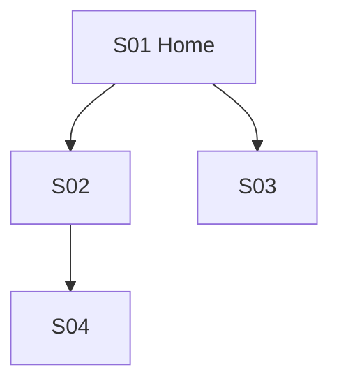

# Information Architecture

| Field | Value |
|---|---|
| Status | Draft |
| Version | v0.1 |
| Owner | <name or role> |

## 1. Navigation model

<Primary navigation pattern (sidebar, top bar, tab bar, hub and spoke) and why it fits the actors and devices in the design brief.>

| Level | Pattern | Items |
|---|---|---|
| Primary | <sidebar / tab bar / …> | <top-level sections> |
| Secondary | <tabs / sub-menu / …> | |
| Utility | <account menu, search, notifications> | |

## 2. Sitemap

## 3. Access by actor

| Section | <Actor 1> | <Actor 2> | Notes |
|---|---|---|---|
| <Section> | Full | View only | <permission from actors-and-permissions> |

## 4. Content hierarchy

For each top-level section, what comes first and why.

| Section | Most important | Secondary | Hidden behind an action |
|---|---|---|---|
| <Section> | <…> | <…> | <…> |

## 5. Search, filters, and sorting

<Where global search exists, what it finds, and which lists offer filters and sorting.>

## Change log

| Version | Date | Change |
|---|---|---|
| v0.1 | <YYYY-MM-DD> | First draft |
