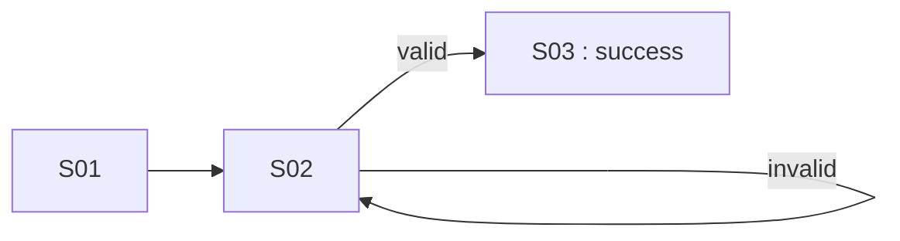

# User Flows

How actors move through screens to complete a journey. One section per flow. A flow realizes one or more journeys from the feature specs (`F04/J-1`); it does not redefine them.

## UF-1: <Flow name>

| Field | Value |
|---|---|
| Actor | <actor> |
| Realizes | <F04/J-1> |
| Starts at | <S01, and what triggers the flow> |
| Ends when | <success outcome> |

| Step | Screen | Actor does | System responds | Requirement |
|---|---|---|---|---|
| 1 | S01 | <action> | <response> | <F04/FR-1> |

**Alternative and error paths**

| Condition | What the actor sees | Recovery | Message |
|---|---|---|---|
| <validation fails / no connection / no permission> | <inline error, banner, …> | <how they continue> | <MSG-001> |
