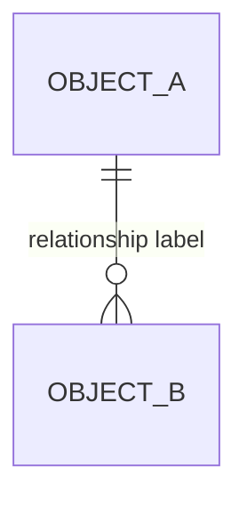
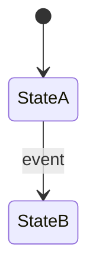

# Domain Model

Conceptual level only: business objects in the users' language, how they relate, and their lifecycles. No column types, keys, indexes, or storage; those belong to the architecture documents.

## Objects

| Object | Meaning | Key business facts | Lifecycle | Introduced by |
|---|---|---|---|---|
| <Object> | <what it represents> | <facts the business cares about> | <state → state> | F01 |

## Relationships

| Object | Relationship | Object | Cardinality |
|---|---|---|---|
| <Object A> | <verb> | <Object B> | 1 : N |

**Notes:** <rules the diagram cannot show, for example "a room has at most one active contract at a time">

## Lifecycles

### <Object>

